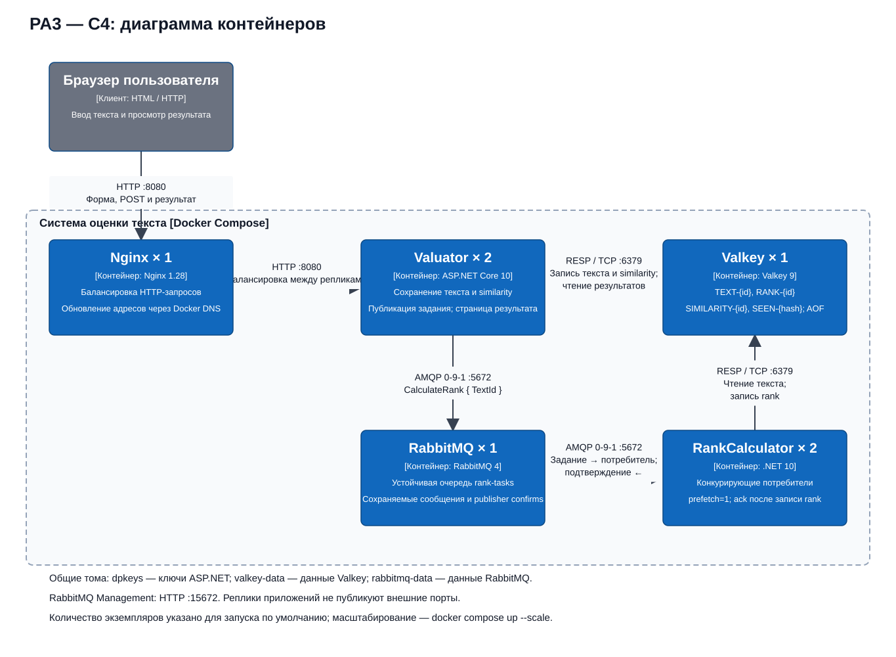

# PA3 — асинхронная оценка текста

Лабораторная выполнена на основе `pa2`. Требования: [PA3](https://github.com/tanyginvv/DISTRIBUTED-PROGRAMMING/tree/pa3).

## Архитектура



Исходник для draw.io: [architecture.drawio](docs/architecture.drawio).

Nginx принимает HTTP-запросы на `localhost:8080` и распределяет их между двумя
репликами Valuator. Docker DNS обновляется каждые 5 секунд; репликам не нужны внешние порты.
Два RankCalculator работают как конкурирующие потребители общей очереди RabbitMQ.

1. POST сохраняет текст в Valkey по ключу `TEXT-{id}`. Пустой ввод — пустая строка.
2. Valuator вычисляет similarity: SHA-256 текста и атомарный `SET NX` по ключу
   `SEEN-{hash}`. Первое появление текста даёт `0`, повторное — `1`.
   Результат сохраняется в `SIMILARITY-{id}`.
3. Valuator публикует JSON `{"TextId":"<uuid>"}` с Type=`CalculateRank` в устойчивую
   очередь `rank-tasks`. Сообщение сохраняемое, публикация использует
   publisher confirms и `mandatory=true`. Вызовы общего канала сериализованы.
4. После подтверждения брокером POST возвращает **302** на `/summary?id=<uuid>`.
   При ошибке сохранения или публикации — **503** с сообщением и сохранённым вводом.
5. RankCalculator получает исходный текст из Valkey и вычисляет долю символов,
   не являющихся латинскими или русскими буквами (`Ёё` включены). Пустой текст имеет rank `0`.
   Алгоритм сохранён из PA2: длина и перебор символов используют UTF-16.
6. Результат записывается в `RANK-{id}`. Затем потребитель отправляет ack.
   Ручное подтверждение и `prefetch=1` позволяют распределять работу между репликами.

Повторная доставка записывает тот же rank. При временной ошибке Valkey
потребитель удерживает неподтверждённое задание и повторяет обработку через
2 секунды. Некорректные задания и ссылки на отсутствующий текст отклоняются
без повторной постановки, с ошибкой в журнале.

Страница результата определяет наличие записи по исходному тексту. Пока rank
отсутствует, она показывает **«Оценка содержания не завершена»**, отдельно similarity
и кнопку **«Обновить результат»**. Неизвестный или неверный ID — **«Запись не найдена.»**.

Redis-клиент автоматически восстанавливает подключение. Потребители RabbitMQ
повторяют первоначальное подключение и создают новую подписку после сбоя;
издатель подключается заново при следующем запросе. Том `dpkeys` общий для
Valuator, поэтому antiforgery работает при GET и POST между разными репликами.
Valkey сохраняет данные через AOF в `valkey-data`, RabbitMQ — в `rabbitmq-data`.

## Запуск и масштабирование

Нужны Docker Engine и Docker Compose с поддержкой `scale`.
Команды выполняются из корня ветки `pa3`:

```bash
docker compose up -d --build
docker compose logs -f
docker compose down
```

Приложение: http://localhost:8080. RabbitMQ Management: http://localhost:15672.
Учётные данные лабораторного брокера: `student` / `student`.
Compose ждёт готовности Valkey и RabbitMQ перед запуском приложений.
`down` сохраняет тома и историю similarity.

По умолчанию запускаются два Valuator и два RankCalculator. Для трёх реплик:

```bash
docker compose up -d --scale valuator=3 --scale rankcalculator=3
```

Экземпляр веб-приложения указан в HTTP-заголовке `X-Valuator-Instance`.
Журналы вычислителей содержат `TextId`, `Instance` и признак `Redelivered`.

## Самостоятельная проверка

Сборка и тесты в ходе подготовки этого коммита не запускались по просьбе пользователя.
Команды для последующей проверки:

```bash
dotnet build DS-course.sln -c Release
dotnet run --project tests/RankCalculator.Tests -c Release
docker compose config --quiet
```

Тестовое приложение содержит 14 случаев для алгоритма, включая пустой текст,
алфавиты, `Ёё`, границы диапазонов, пунктуацию, пробелы, emoji и повторный расчёт.

| Сценарий | Ожидаемый результат |
| --- | --- |
| Отправка `abc!` через форму | POST 302; rank `0.25`; similarity `0` при первом появлении, `1` при повторном |
| Пустая форма | Запись существует, rank `0` |
| `/summary?id=invalid` или неизвестный UUID | Запись не найдена |
| Остановка RankCalculator и отправка текста | POST 302; сообщение об ожидании и значение similarity |
| Запуск RankCalculator и обновление результата | Появляется вычисленный rank |
| Серия разных текстов | В журнале есть задания от обоих вычислителей |
| Остановка обработчика до ack | Повторная доставка, итоговый rank не меняется |
| Временная остановка Valkey | Повторные попытки обработки с задержкой; после запуска сохраняется результат |
| Отправка при остановленном RabbitMQ | 503 с понятной ошибкой, без успешного перенаправления |
| Перезапуск RabbitMQ | Вычислители восстанавливают подписки, новые формы снова принимаются |
| Масштабирование до трёх реплик | Nginx обнаруживает новые Valuator, задания распределяются между вычислителями |
| GET формы и POST между разными Valuator | Antiforgery-cookie принимается благодаря общим ключам |

Ожидание результата можно увидеть так:

```bash
docker compose stop rankcalculator
# Отправьте новый текст через браузер и откройте результат.
docker compose start rankcalculator
# Обновите страницу результата.
```

Для остановки до подтверждения можно включить задержку обработки:

```bash
RANK_DELAY_MS=10000 docker compose up -d --force-recreate rankcalculator
docker compose logs -f rankcalculator
# После строки Processing выполните в другом терминале:
docker compose kill -s SIGKILL rankcalculator
docker compose up -d rankcalculator
```

В журнале повторной обработки ожидается `Redelivered=True`. Последняя команда
возвращает обычную скорость, если переменная `RANK_DELAY_MS` не экспортирована.

HTTP, Valkey и RabbitMQ не объединены транзакцией. При ошибке публикации
сохранённый текст и SEEN-ключ могут остаться в базе; повторная отправка создаёт
новый TextId. Задания доставляются как минимум один раз.
